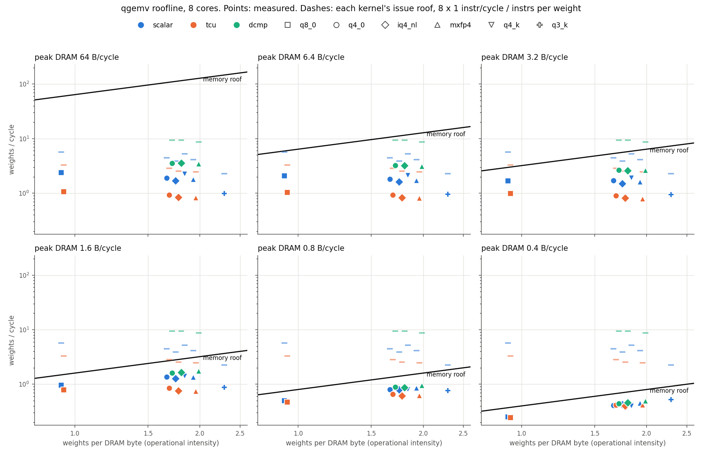
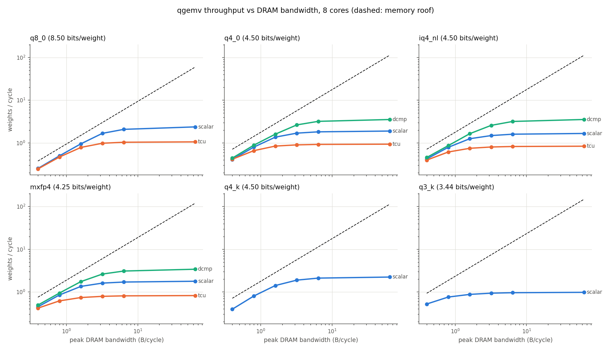

# qgemv roofline

This directory holds the measured roofline for the quantized GEMV kernels: every weight format and decode engine, swept across DRAM bandwidth on 8 cores in SimX.

- `sweep.sh` runs the sweep and writes a CSV.
- `plot.py` turns the CSV into the two figures and `summary.md`.
- `results/` holds the data and figures from the run described below.

## Setup

| | |
|---|---|
| Shape | y = W x, M = 1024 rows, K = 2048 (2 M weights) |
| Machine | 8 cores, 4 warps x 4 threads each, issue width 1, L2 on |
| Preset | `QDEC_DCMP` from `../configs.sh` (TCU fp16, Zfhmin, DCMP.LD), so all engines run on the same hardware |
| Bandwidth | 1-2 HBM2 channels; `DATA_RATE` swept from 800 down to 10 |

Two simulator details matter for the bandwidth numbers:

- **Peak bandwidth.** `VX_CFG_PLATFORM_MEMORY_PEAK_BW` does not change SimX timing. The DRAM model's peak is `NUM_BANKS x 16 B x DATA_RATE / 400` bytes per core cycle, so it is set through `NUM_BANKS` and `DATA_RATE`.
- **Upload traffic.** `VX_CFG_CP_LLC_CLIENT=0` keeps the host's weight upload out of the timed DRAM model. With the command processor on the L2 (the default), the upload is charged to the kernel and roughly doubles its DRAM traffic.

Throughput is weights per core cycle, M·K / cycles. Every run checks its output against ggml's reference.

## Engines

| engine | how a weight reaches the multiply |
|---|---|
| scalar | integer dot product against int8 activations (Q8_0 / Q8_K), with the scale applied per block, as in ggml's CPU kernels |
| tcu | the weight is decoded in software to fp16, scaled, then multiplied on the tensor core (WMMA, 8x4x8 tiles) |
| dcmp | the same as tcu, but one `DCMP.LD` loads a byte and returns its two scaled fp16 weights, so the per-weight decode becomes a single instruction |

## Results





Throughput in weights per cycle (higher is better). The best result at each bandwidth is in bold.

| format | engine | instrs/weight | 64 B/c | 6.4 B/c | 3.2 B/c | 1.6 B/c | 0.8 B/c | 0.4 B/c |
|---|---|---|---|---|---|---|---|---|
| q8_0 | scalar | 1.40 | 2.38 | 2.08 | 1.68 | 0.95 | 0.50 | 0.25 |
| q4_0 | scalar | 1.80 | 1.90 | 1.82 | 1.70 | 1.37 | 0.80 | 0.41 |
| iq4_nl | scalar | 2.05 | 1.67 | 1.60 | 1.49 | 1.25 | 0.79 | 0.42 |
| mxfp4 | scalar | 1.94 | 1.78 | 1.71 | 1.61 | 1.35 | 0.85 | 0.45 |
| q4_k | scalar | 1.53 | 2.23 | 2.11 | 1.89 | 1.41 | 0.80 | 0.39 |
| q3_k | scalar | 3.54 | 0.98 | 0.96 | 0.94 | 0.88 | 0.76 | **0.52** |
| q8_0 | tcu | 2.44 | 1.06 | 1.04 | 0.98 | 0.79 | 0.47 | 0.25 |
| q4_0 | tcu | 2.81 | 0.93 | 0.92 | 0.90 | 0.84 | 0.66 | 0.41 |
| iq4_nl | tcu | 3.15 | 0.84 | 0.83 | 0.80 | 0.75 | 0.61 | 0.40 |
| mxfp4 | tcu | 3.26 | 0.82 | 0.81 | 0.79 | 0.74 | 0.62 | 0.42 |
| q4_0 | dcmp | 0.85 | 3.54 | **3.21** | **2.65** | 1.60 | 0.89 | 0.44 |
| iq4_nl | dcmp | 0.85 | **3.54** | 3.19 | 2.58 | 1.65 | 0.86 | 0.46 |
| mxfp4 | dcmp | 0.92 | 3.41 | 3.09 | 2.63 | **1.75** | **0.94** | 0.49 |

| peak B/cycle | fastest | weights/cycle | measured DRAM traffic / peak |
|---|---|---|---|
| 64 | iq4_nl dcmp | 3.54 | 3% |
| 6.4 | q4_0 dcmp | 3.21 | 29% |
| 3.2 | q4_0 dcmp | 2.65 | 48% |
| 1.6 | mxfp4 dcmp | 1.75 | 60% |
| 0.8 | mxfp4 dcmp | 0.94 | 64% |
| 0.4 | q3_k scalar | 0.52 | 58% |

## Findings

1. **Software decode is the bottleneck down to about 1.6 B/cycle.** Above that, every scalar and tcu kernel sits far below its memory roof. Each scalar 4-bit kernel tops out at 1.7-2.2 weights/cycle whatever the bandwidth, and q8_0 beats the 4-bit formats at 64 B/cycle because it decodes more cheaply.

2. **Software decode makes the tensor core slower than scalar code.** Decoding two weights into an fp16 pair costs about 2.8-3.3 instructions per weight. So the tcu engine is 2× slower than scalar at high bandwidth: the TCU's multiply throughput is wasted while the core decodes.

3. **DCMP.LD removes the decode cost.** It cuts instructions per weight from 2.8-3.3 (tcu) to 0.85-0.92. At high bandwidth that makes dcmp 3.8× faster than the tcu engine and 1.5× faster than the best scalar kernel (q8_0 at 64 B/cycle, q4_k at 6.4). dcmp is the fastest kernel from 64 down to 0.8 B/cycle.

4. **At low bandwidth every engine converges on the memory roof,** and the format's size decides the winner. At 0.4 B/cycle, q3_k (3.44 bits/weight) beats every 4-bit kernel, dcmp included, even with 3.5 instructions per weight. This is the crossover DECA targets. A 3-bit dcmp would extend the dcmp lead into this regime, but DCMP.LD v1 decodes only 4-bit codes.

5. **Achieved bandwidth stays at 55-65% of peak** even when memory is the bottleneck. The rest is presumably lost to DRAM-model efficiency and limits on requests in flight; this was not investigated further.

## Kernel fixes made for this sweep

The first 8-core sweep showed dcmp slower than scalar. Its memory counters showed more DRAM writes than reads, which a GEMV should never do. There were three causes:

- **Register spills in the tcu/dcmp kernels.** They held a scale and two offsets for each of the 8 A-fragment registers (24 values). These spilled to the stack every block, and with an 8-core write-through L1 the spill stores went to DRAM. A lane's 8 registers cover only 4 weight rows, in K-adjacent pairs, so the kernel now keeps one scale and one row pointer per pair. It checks that layout at startup and poisons its output if the layout differs.
- **The DCMP.LD tile loop is no longer unrolled.** DCMP.LD has no address immediate, so each load needs its own address register, and the 4× unroll ran out of integer registers.
- **The tcu engine packs fp16 pairs with bit casts** instead of a `memcpy` through the stack. This makes the software-decode baseline fair.

Together these took q4_0 dcmp from 1.54 to 0.85 instructions per weight. The earlier 4- and 8-core scalar sweeps (L2 with the command processor on it) are superseded by this one: they included the upload traffic.

## Reproduce

Run these inside the container (`docker/vx`), from a configured build directory:

```sh
../tests/regression/qgemv/roofline/sweep.sh roofline.csv   # ~1 h; knobs: CORES, BW, M, K
python3 ../tests/regression/qgemv/roofline/plot.py roofline.csv out/
```
